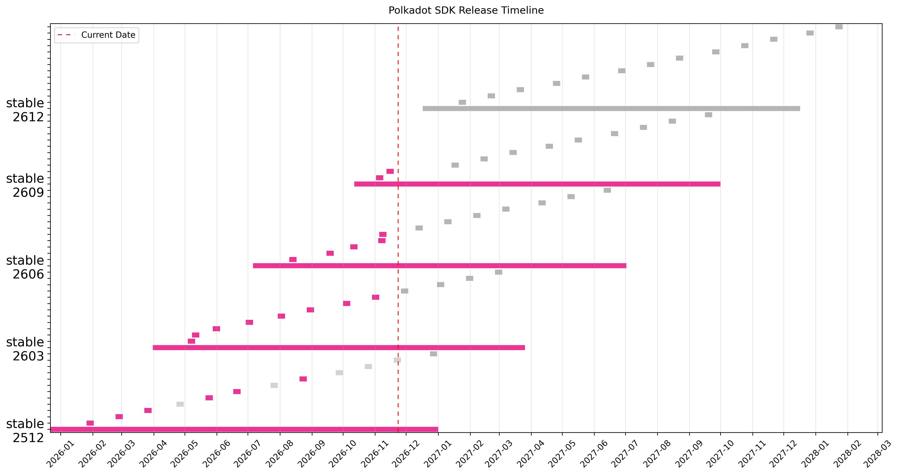
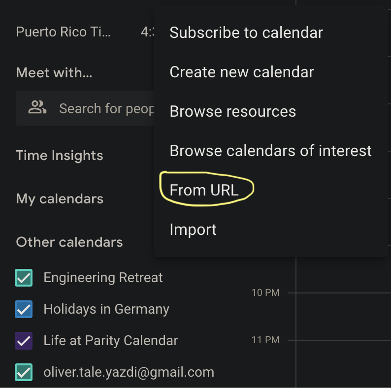
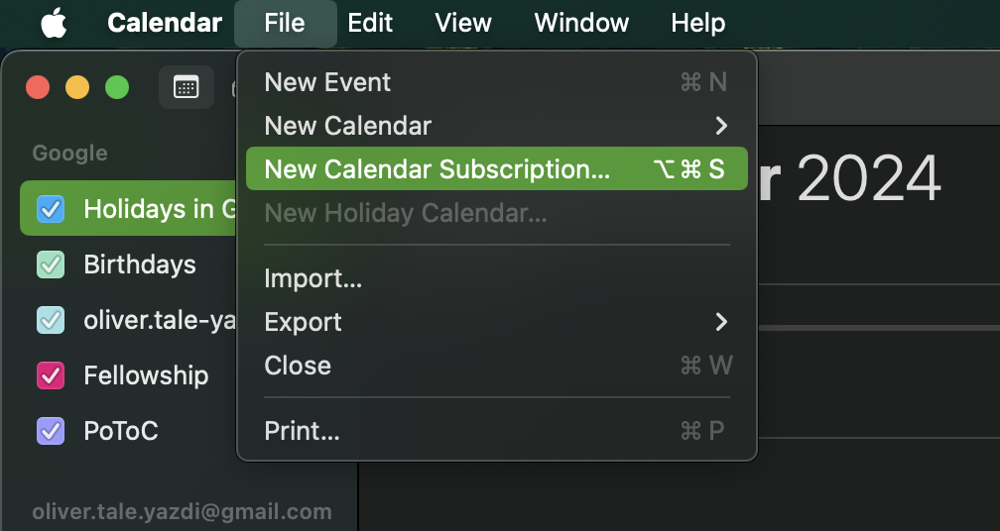
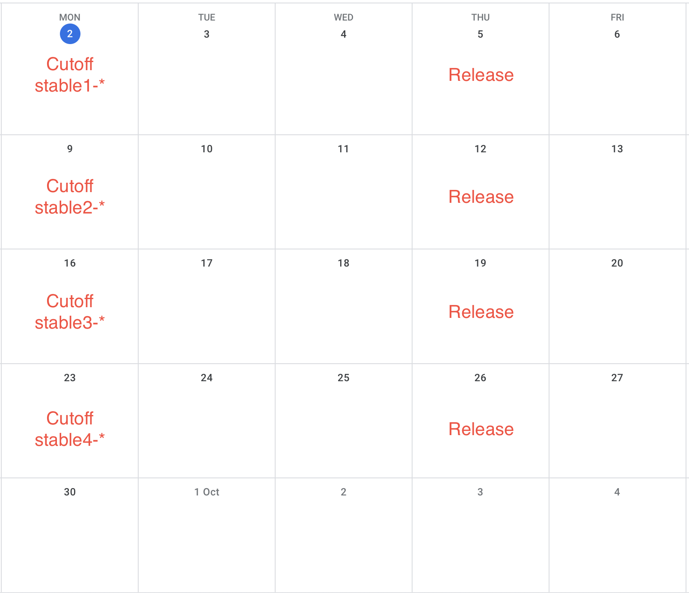

# Release Registry

[](#)&nbsp;&nbsp;[](#)

Single source of truth regarding past and future releases of the Polkadot SDK.

This repo contains a [releases-v1.json](./releases-v1.json) file that tracks all SDK releases and a [JSON schema](./releases-v1.schema.json) to ensure that it is in canonical format.

This chart shows the released (pink) and planned (grey) releases. The row at the top shows the monthly releases: each one is supported from the day it is published until the next one replaces it. Below are the quarterly releases that are still supported. Their long bars are the releases and the small ones are the patches on top of them.



## Calendar

Planned and historic release dates:

<!-- DO NOT EDIT. Run `python3 update-readme.py` instead. -->

<!-- TEMPLATE BEGIN -->

| Version | SemVer | Cutoff | Publish | End of Life | State |
|---------|--------|--------|---------|-------------|-------|
| **stable2704** | 1.31.0 | 2027-04-26 | 2027-04-29 | 2027-05-27 | Planned |
| **stable2703** | 1.30.0 | 2027-03-22 | 2027-03-25 | 2027-04-29 | Planned |
| **stable2702** | 1.29.0 | 2027-02-22 | 2027-02-25 | 2027-03-25 | Planned |
| **stable2701** | 1.28.0 | 2027-01-25 | 2027-01-28 | 2027-02-25 | Planned |
| **stable2612** | 1.27.0 | 2026-12-14 | 2026-12-17 | 2027-01-28 | Planned |
| **stable2611** | 1.26.0 | 2026-11-23 | 2026-11-26 | 2026-12-17 | Planned |
| **stable2609** | 1.25.0 | 2026-08-17 | 2026-10-12 | 2027-10-01 | [Released](https://github.com/paritytech/polkadot-sdk/releases/tag/polkadot-stable2609) |
| &nbsp;&nbsp;stable2609-1 | 1.25.1 | 2026-11-02 | 2026-11-02 |  | [Released](https://github.com/paritytech/polkadot-sdk/releases/tag/polkadot-stable2609-1) |
| &nbsp;&nbsp;stable2609-2 | 1.25.2 | 2026-11-12 | 2026-11-12 |  | [Released](https://github.com/paritytech/polkadot-sdk/releases/tag/polkadot-stable2609-2) |
| &nbsp;&nbsp;stable2609-3 | 1.25.3 | 2027-01-11 | 2027-01-14 |  | Planned |
| &nbsp;&nbsp;stable2609-4 | 1.25.4 | 2027-02-08 | 2027-02-11 |  | Planned |
| &nbsp;&nbsp;[7 more planned](CALENDAR.md) |  |  | | |
| **stable2606** | 1.24.0 | 2026-05-18 | 2026-07-06 | 2027-07-02 | [Released](https://github.com/paritytech/polkadot-sdk/releases/tag/polkadot-stable2606) |
| &nbsp;&nbsp;stable2606-4 | 1.24.4 | 2026-11-04 | 2026-11-04 |  | [Released](https://github.com/paritytech/polkadot-sdk/releases/tag/polkadot-stable2606-4) |
| &nbsp;&nbsp;stable2606-5 | 1.24.5 | 2026-11-05 | 2026-11-05 |  | [Released](https://github.com/paritytech/polkadot-sdk/releases/tag/polkadot-stable2606-5) |
| &nbsp;&nbsp;stable2606-6 | 1.24.6 | 2026-12-07 | 2026-12-10 |  | Planned |
| &nbsp;&nbsp;stable2606-7 | 1.24.7 | 2027-01-04 | 2027-01-07 |  | Planned |
| &nbsp;&nbsp;[3 more past, 5 more planned](CALENDAR.md) |  |  | | |
| **stable2603** | 1.22.0 | 2026-02-09 | 2026-03-31 | 2027-03-26 | [Released](https://github.com/paritytech/polkadot-sdk/releases/tag/polkadot-stable2603) |
| &nbsp;&nbsp;stable2603-7 | 1.22.7 | 2026-10-01 | 2026-10-01 |  | [Released](https://github.com/paritytech/polkadot-sdk/releases/tag/polkadot-stable2603-7) |
| &nbsp;&nbsp;stable2603-8 | 1.22.8 | 2026-10-29 | 2026-10-29 |  | [Released](https://github.com/paritytech/polkadot-sdk/releases/tag/polkadot-stable2603-8) |
| &nbsp;&nbsp;stable2603-9 | 1.22.9 | 2026-11-23 | 2026-11-26 |  | Planned |
| &nbsp;&nbsp;stable2603-10 | 1.22.10 | 2026-12-28 | 2026-12-31 |  | Planned |
| &nbsp;&nbsp;[6 more past, 2 more planned](CALENDAR.md) |  |  | | |
| **stable2512** | 1.21.0 | 2025-11-17 | 2025-12-22 | 2027-01-01 | [Released](https://github.com/paritytech/polkadot-sdk/releases/tag/polkadot-stable2512) |
| &nbsp;&nbsp;stable2512-10 | 1.21.10 | 2026-10-19 | 2026-10-22 |  | ~~Cancelled~~ |
| &nbsp;&nbsp;stable2512-11 | 1.21.11 | 2026-11-16 | 2026-11-19 |  | ~~Cancelled~~ |
| &nbsp;&nbsp;stable2512-12 | 1.21.12 | 2026-12-21 | 2026-12-24 |  | Planned |
| &nbsp;&nbsp;[9 more past](CALENDAR.md) |  |  | | |
| **stable2509** | 1.20.0 | 2025-08-18 | 2025-10-08 | 2026-10-02 | ~~[Deprecated](https://github.com/paritytech/polkadot-sdk/releases/tag/polkadot-stable2509)~~ |
| &nbsp;&nbsp;stable2509-11 | 1.20.11 | 2026-08-13 | 2026-08-13 |  | ~~[Deprecated](https://github.com/paritytech/polkadot-sdk/releases/tag/polkadot-stable2509-11)~~ |
| &nbsp;&nbsp;stable2509-12 | 1.20.12 | 2026-09-14 | 2026-09-17 |  | ~~Cancelled~~ |
| &nbsp;&nbsp;[10 more past](CALENDAR.md) |  |  | | |
| **stable2506** | 1.19.0 | 2025-05-15 | 2025-07-24 | 2026-06-30 | ~~[Deprecated](https://github.com/paritytech/polkadot-sdk/releases/tag/polkadot-stable2506)~~ |
| &nbsp;&nbsp;stable2506-11 | 1.19.11 | 2026-05-07 | 2026-05-07 |  | ~~[Deprecated](https://github.com/paritytech/polkadot-sdk/releases/tag/polkadot-stable2506-11)~~ |
| &nbsp;&nbsp;stable2506-12 | 1.19.12 | 2026-06-10 | 2026-06-10 |  | ~~[Deprecated](https://github.com/paritytech/polkadot-sdk/releases/tag/polkadot-stable2506-12)~~ |
| &nbsp;&nbsp;[10 more past](CALENDAR.md) |  |  | | |
| **stable2503** | 1.18.0 | 2025-02-17 | 2025-04-08 | 2026-03-31 | ~~[Deprecated](https://github.com/paritytech/polkadot-sdk/releases/tag/polkadot-stable2503)~~ |
| &nbsp;&nbsp;stable2503-13 | 1.18.13 | 2025-12-22 | 2025-12-25 |  | ~~Cancelled~~ |
| &nbsp;&nbsp;stable2503-14 | 1.18.14 | 2026-01-26 | 2026-01-29 |  | ~~Cancelled~~ |
| &nbsp;&nbsp;[12 more past](CALENDAR.md) |  |  | | |
| **stable2412** | 1.17.0 | 2024-11-06 | 2024-12-17 | 2025-12-16 | ~~[Deprecated](https://github.com/paritytech/polkadot-sdk/releases/tag/polkadot-stable2412)~~ |
| &nbsp;&nbsp;stable2412-12 | 1.17.12 | 2025-11-17 | 2025-11-20 |  | ~~Cancelled~~ |
| &nbsp;&nbsp;stable2412-13 | 1.17.13 | 2025-12-15 | 2025-12-18 |  | ~~Cancelled~~ |
| &nbsp;&nbsp;[11 more past](CALENDAR.md) |  |  | | |
| **stable2409** | 1.16.0 | 2024-09-02 | 2025-06-12 | 2025-09-25 | ~~[Deprecated](https://github.com/paritytech/polkadot-sdk/releases/tag/polkadot-stable2409)~~ |
| &nbsp;&nbsp;stable2409-12 | 1.16.12 | 2025-09-11 | 2025-09-11 |  | ~~[Deprecated](https://github.com/paritytech/polkadot-sdk/releases/tag/polkadot-stable2409-12)~~ |
| &nbsp;&nbsp;stable2409-13 |  | 2025-10-13 | 2025-10-16 |  | ~~Cancelled~~ |
| &nbsp;&nbsp;[11 more past](CALENDAR.md) |  |  | | |
| **stable2407** | 1.15.0 | 2024-04-29 | 2024-04-29 | 2025-04-29 | ~~[Deprecated](https://github.com/paritytech/polkadot-sdk/releases/tag/polkadot-stable2407)~~ |
| &nbsp;&nbsp;stable2407-9 | 1.15.9 | 2025-04-10 | 2025-04-10 |  | ~~[Deprecated](https://github.com/paritytech/polkadot-sdk/releases/tag/polkadot-stable2407-9)~~ |
| &nbsp;&nbsp;stable2407-10 |  | 2025-05-05 | 2025-05-08 |  | ~~Cancelled~~ |
| &nbsp;&nbsp;[8 more past](CALENDAR.md) |  |  | | |

<!-- TEMPLATE END -->

### Subscribe

Subscribe to the calendar by adding this iCal link to your Google or Apple calendar:

`https://raw.githubusercontent.com/paritytech/release-registry/main/releases-v1.ics`

 Google has an "From URL" and Apple "New Calendar Subscription" option for this:

 Google            |  Apple
:-------------------------:|:-------------------------:
  |  

## Schedule

### Releases

The Polkadot SDK has a `stableYYMM` release every 3 months. Each stable release is supported for one year through a monthly patching schedule. The releases are not *exactly* 3 months apart, but we try to keep it close. The exact dates are in the calendar.  
Stable releases undergo a 1.5 month QA period before being published. This explains the difference between the `cutoff` and `published` dates.

### Patches

Patches have the tag format `stableYYMM-PATCH` where `PATCH` ranges from 1 to 99. There is no zero padding present, example: `stable2407-1` or `stable2409-10`.

The patching schedule of each stable release is assigned a week of the month. This works well, since there can be at most four stable releases maintained at once.  For example: release `stable2407` is always patched in the first week of a month. This means that on the first Monday of each month, a new patch is cut off, and on the first Thursday after that Monday, it is published.



## Goals

The two main goals of this repo are to improve:
- **Communication**: clear information about past and upcoming releases. Hoarding information inside Parity is not helpful. This repo aims to make it easier for the Polkadot Ecosystem to know what's going on. This can be helpful to all departments; developers, marketing, devops, security etc.
- **Expectations**: set clear expectations by having a public schedule. Know when what is coming.

## Maintenance

All changes to the JSON go through [manage.py](./scripts/manage.py): either with the `just` commands below, or with the workflows in the Actions tab, which run the same commands and open a PR against `main`. After a local change, run `just`. It checks the JSON against the schema and updates the README, the calendar, the badges and the chart.

A command that does not fit fails with an error and leaves the JSON as it is. This is the case for a release or patch that does not exist, for a release that is already out and would be planned, cut off or skipped again, and for a patch that would be published before its release.

### Maintaining monthly releases

Releases from `stable2611` on are monthly and have `"cadence": "monthly"` in the JSON. Most of their data follows from rules, so it does not have to be typed in:

- **Dates**: the cutoff is the last Monday of the month whose Friday is still in the same month. The release is published on the Thursday of that week.
- **SemVer**: every release has the minor version of the release before it plus one, for example `1.26.0` for `stable2611` and `1.27.0` for `stable2612`.
- **End of life**: a release is supported until the next one is published.
- **Planning**: the next six releases are always planned.

#### Publishing a release

In a normal month this is the only step. On the day the release is published on GitHub, run:

```bash
just publish stable2611 2026-11-26
```

Or trigger the **New release** workflow (`.github/workflows/new-release.yml`) with the release name and the date. This marks the release as released, deprecates the monthly release before it and plans one more release, so that six stay planned.

A release can only be published once the monthly releases before it are published or skipped.

#### Moving a release to another week

Pass the new cutoff date. It has to be a Monday, and the publish date becomes the Thursday of that week:

```bash
just plan stable2612 2026-12-14
```

The **Plan release** workflow (`.github/workflows/plan-release.yml`) does the same. It takes the release name, the cutoff date and optionally a node version. The node version is only needed for a first monthly release, which has no previous one to derive it from.

#### Skipping a release

```bash
just skip stable2701
```

Or trigger the **Skip release** workflow (`.github/workflows/skip-release.yml`). A skipped release does not use up a version number: the planned releases after it move down by one minor version. To bring a skipped release back, plan it again with `just plan`. That is no longer possible once a later release is cut off or released.

#### Publishing with a different SemVer

If a release gets another version than the planned one, for example a new major version, pass it when publishing. The planned releases after it follow from that version:

```bash
just publish stable2701 2027-01-28 2.0.0
```

#### Patches

Monthly releases have no patch schedule. If one needs a patch, announce it with `plan` and record it with `publish` once it is out. `publish` alone is enough if the patch was not announced:

```bash
just plan stable2611-1 2026-12-03
just publish stable2611-1 2026-12-03
```

#### Other commands

```bash
just plan-ahead               # plan releases until six are planned, e.g. after a skip
just recommend stable2609 2   # set the recommended release, the patch number is optional
```

The recommended release is what the "Latest Release" badge shows. It is set by hand. It only moves by itself if it points to a monthly release that is replaced by the next one.

### Maintaining quarterly releases (legacy)

`stable2512`, `stable2603`, `stable2606` and `stable2609` are the last quarterly releases. They keep their monthly patching schedule until their end of life, and no new quarterly release is planned. The commands below remain for them.

#### Release Planning
(how to add a new quarterly release to the json)

First, check the calendar when about 3 months passed from the publish date of the last release. Then subtract about 1.5 months from that and call the plan command with that date. Releases are planned as monthly ones unless `--cadence quarterly` is given:

```bash
python3 scripts/manage.py release plan stable2412 2024-11-06 1.17.0 --cadence quarterly
```

Then figure out when the first patch date should be; you have to select a Monday for the patching schedule to be calculated (errors if not a Monday). You should select either a week that is empty and has no schedule, or the one where the oldest release is currently being patched.  
The script will then count the how many-th monday of the month it is and begin lining it up with the months like in the image above.

Example where we want the first patch to be cut off on 2024-07-29:

```bash
python3 scripts/manage.py backfill-patches stable2407 --start-date 2024-07-29
```

Then update the README to see the changes by running `just`.

#### Release Cutoff / Publish

Run this command to cut off a release or patch:

```bash
python3 scripts/manage.py release cutoff stable2407-2 2024-09-02
```

With `publish` likewise.

Publishing can also be done on GitHub: trigger the **New release** workflow (`.github/workflows/new-release.yml`) from the Actions tab. It takes the release name and date as inputs, runs the `publish` command, regenerates all derived files, and opens a PR against `main`.

#### Release Deprecation

Once a release reaches its end of life, deprecate it and point users at its successor. Already released patches get marked as deprecated too, while the remaining planned ones are skipped:

```bash
python3 scripts/manage.py deprecate stable2509 2026-09-21 stable2606
```

Deprecating can also be done on GitHub: trigger the **Deprecate release** workflow (`.github/workflows/deprecate-release.yml`) from the Actions tab. It takes the release name, deprecation date and the release to use instead as inputs, runs the `deprecate` command, regenerates all derived files, and opens a PR against `main`.

## Automation

Two scripts are currently in place to:

- [manage.py](./scripts/manage.py) - manage the releases json file (plan, cutoff, publish, etc)
- [update-readme.py](./scripts/update-readme.py) - updates the README.md file with the data from the releases.json file
- [update-calendar.py](./scripts/update-calendar.py) - generates an iCal file from the releases.json file
- [update-badges.py](./scripts/update-badges.py) - re-generate the badges in the `badges` folder for downstream use.
